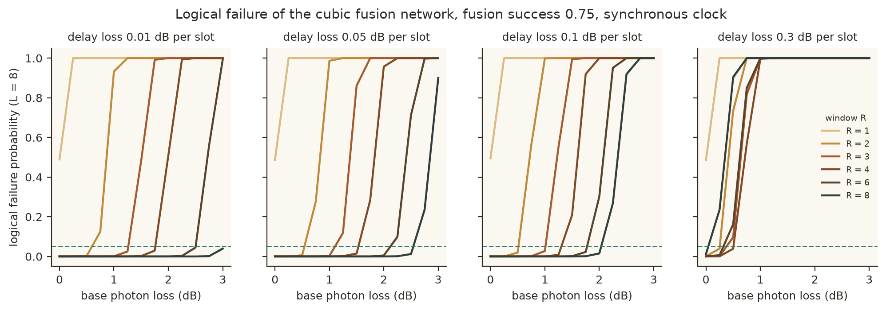
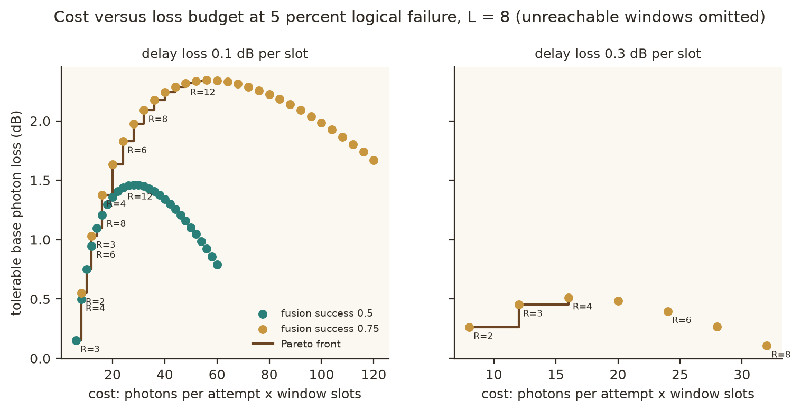
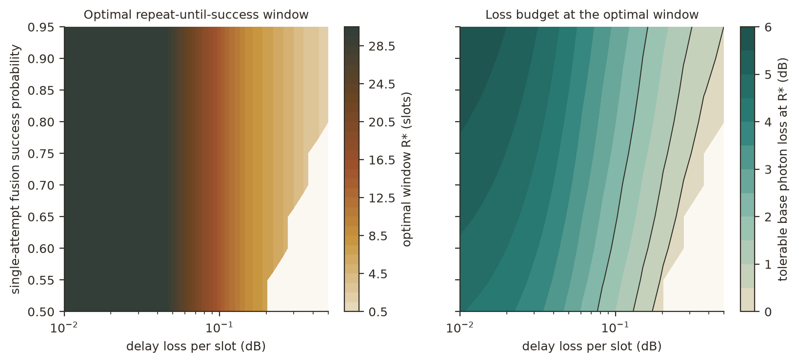
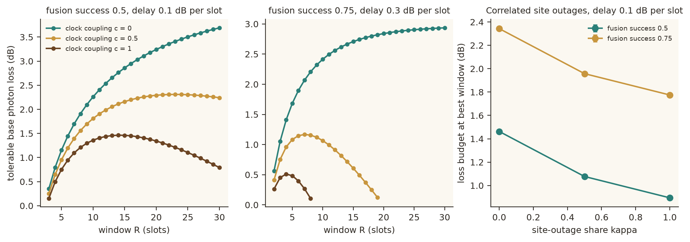
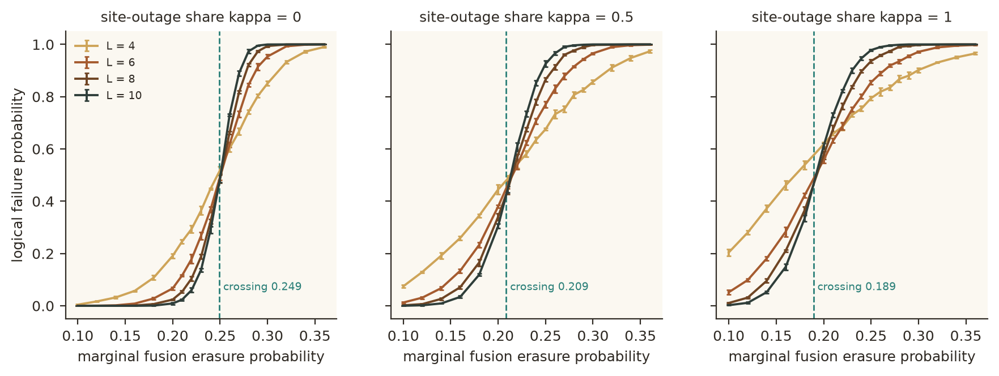

# How many retries should a photonic fusion node get?

[](LICENSE)
[](pyproject.toml)
[](https://github.com/pradeepdegalaroyal/fusion-retry-window-delay-loss-budget/actions/workflows/ci.yml)

**Repeat-until-success windows against delay-line loss in a periodic cubic fusion network (simulation study).**

**Abstract.** Repeating a failed fusion buys photon-loss tolerance, but every retry keeps photons in delay lines, so the
length of the retry window is a design variable with a cost. This study prices that window with a synchronous-clock
delay-loss model and combines it with a Monte Carlo erasure-correctability test on a periodic cubic fusion network
(L = 4 to 10, 5 seeds) to obtain a tolerable-photon-loss budget and an optimal window. In this simulated proxy the
budget has a finite optimum (14 slots at 0.1 dB delay loss per slot) and retrying without limit costs 0.67 dB of budget;
no hardware was measured and no quantum advantage is claimed.

Continuous integration (CI) runs the tests and a smoke run of every experiment on each push.

## Motivation

Fusion-based photonic quantum computing builds a large entangled state out of small resource states by measuring pairs of
photons ("fusions"). A linear-optics fusion fails with a heralded probability, and a lost photon is also a heralded
failure; both leave an *erased* outcome that the code must correct. Emitter-based architectures can simply try again.
How many tries are worth their loss is the question this repository answers for a transparent toy model of the whole
stack.

## Research gap

Recent work builds quantum low-density parity-check (qLDPC) codes from fusions of emitter-made resource states and uses a
conditional repeat-until-success (RUS) strategy for loss tolerance (Chen et al., 2026, doi:10.1038/s41534-026-01233-y).
System-level work maps facet loss and detection efficiency to cloud throughput and tail latency (Yousif et al., 2027,
doi:10.1007/978-3-032-39708-9_27), and reviews name loss management and large-scale integration as bottlenecks
(Slussarenko and Pryde, 2019, doi:10.1063/1.5115814; Nusyura et al., 2026, doi:10.1007/s42484-026-00402-8; Elshaari et al.,
2020, doi:10.1038/s41566-020-0609-x). Error-correction theory supplies the erasure-tolerance side (Terhal, 2015,
doi:10.1103/RevModPhys.87.307). What is missing is a quantitative price for the retry window itself. The full related-work
table is in [`docs/RESEARCH_GAP.md`](docs/RESEARCH_GAP.md).

## What is new here

- The RUS window length R is treated as a design variable and priced by delay-line loss, including a synchronous-clock
  term c in which every photon of the network waits for the longest window.
- A union-find erasure-correctability test (winding-cycle detection) turns the fusion erasure probability into a
  tolerable-loss budget at a stated logical failure target, instead of stopping at the erasure probability.
- Both an ablation (switch the clock penalty off) and a robustness sweep (correlated whole-node outages) are reported with
  seeds, including a negative result about what the lattice simulation does and does not change.

## Method at a glance

```mermaid
%%{init: {'theme': 'base', 'themeVariables': {'primaryColor': '#ffffff', 'primaryTextColor': '#000000', 'primaryBorderColor': '#000000', 'lineColor': '#000000', 'secondaryColor': '#ffffff', 'tertiaryColor': '#ffffff', 'background': '#ffffff', 'noteBkgColor': '#ffffff', 'noteTextColor': '#000000', 'actorBkg': '#ffffff', 'actorBorder': '#000000', 'actorTextColor': '#000000', 'signalColor': '#000000', 'signalTextColor': '#000000', 'labelBoxBkgColor': '#ffffff', 'labelTextColor': '#000000', 'clusterBkg': '#ffffff', 'clusterBorder': '#000000'}}}%%
stateDiagram-v2
    state "Window opens: R slots reserved<br/>every photon pays idle loss" as W
    state "Attempt k: both photons survive<br/>and the fusion succeeds?" as A
    state "Heralded failure: wait one slot<br/>retry while k is below R" as F
    state "Outcome obtained<br/>edge kept" as K
    state "All R attempts failed<br/>edge erased" as E
    state "Lattice check in lattice.py:<br/>do erased edges hold a winding cycle?" as C
    state "Logical failure" as X
    state "Logical memory preserved" as Y
    [*] --> W
    W --> A
    A --> K
    A --> F
    F --> A
    F --> E
    K --> C
    E --> C
    C --> X
    C --> Y
    X --> [*]
    Y --> [*]
```

Legend: the loop between the attempt and the heralded failure runs at most R times; the lattice check is the
union-find kernel in `src/fusionretry/lattice.py`; the analytic node model is `src/fusionretry/model.py`.

In words: one fusion succeeds on attempt k with probability p_s times the squared photon transmission, where the
transmission falls with a base loss l0, with k slots of retry delay and with the clock-coupled share c of the window
(`docs/METHOD.md`). The probability that all R attempts fail is the erasure probability of an edge of an L x L x L periodic
cubic lattice; the edge set is correctable unless it contains a non-contractible cycle. The tolerable base loss l0* is the
largest l0 whose erasure probability stays at the level where the L = 8 network fails in 5 percent of trials.

## Results: three claims

All numbers below are read from `results/` (summary in `results/summary.json` and `results/headline_numbers.json`);
uncertainties are the standard deviation over 5 seeds of the Monte Carlo failure curve, propagated into the budget.

**Calibration.** The measured crossing of the failure curves of the two largest lattices (L = 8 and 10) is
0.2493 ± 0.0023 for independent erasure, close to the known bond-percolation value of the cubic lattice, which supports the
correctness of the winding-cycle kernel. The erasure level giving 5 percent failure at L = 8 is 0.2088 ± 0.0011.

| Site-outage share kappa | crossing L = 4/6 | crossing L = 6/8 | crossing L = 8/10 | erasure at 5 percent failure, L = 8 |
|---|---|---|---|---|
| 0 | 0.2572 ± 0.0023 | 0.2511 ± 0.0023 | 0.2493 ± 0.0023 | 0.2088 ± 0.0011 |
| 0.5 | 0.2185 ± 0.0051 | 0.2137 ± 0.0016 | 0.2086 ± 0.0026 | 0.1506 ± 0.0021 |
| 1 | 0.2196 ± 0.0034 | 0.1954 ± 0.0029 | 0.1894 ± 0.0045 | 0.1258 ± 0.0007 |

### Claim 1. Single-attempt fusion cannot reach the target here; a retry window is a requirement, not a tweak



*Takeaway: each extra slot shifts the failure curve to higher photon loss until the delay loss takes over (rightmost panel).*

Standard single-attempt fusion (success 0.5) and boosted fusion (success 0.75) have a loss budget of zero at every delay
loss on the grid, because their erasure probability stays above the 5 percent-failure level even with lossless photons
(`results/headline_numbers.json`, `results/summary.json`: reachable fraction 0.0 for both). At 0.1 dB delay loss per slot
the smallest usable window is 3 slots for success 0.5 (budget 0.151 dB) and 2 slots for success 0.75 (budget 0.552 dB).
*Caveat:* the proxy lattice has a 0.249 erasure threshold, harsher than the resource-state-specific fusion networks of
real architectures, so the absolute budgets are not transferable; the trend is the claim.

### Claim 2. Under a synchronous clock the budget has a finite optimum, and unbounded retrying is harmful



*Takeaway: the Pareto front rises steeply for the first few slots and flattens; the best window is not the largest.*



*Takeaway: the optimal window shrinks from the search cap (30 slots) at small delay loss to 4 slots near 0.3 dB, and the
unreachable region (8.6 percent of the grid) appears at high delay loss and low fusion success.*



*Takeaway: removing the clock penalty (c = 0) makes the budget grow with every attempt; the penalty is what creates the optimum.*

| Fusion success | Delay loss (dB per slot) | R* (window) | Budget at R* (dB) | R = 1 reachable | R = 30 reachable |
|---|---|---|---|---|---|
| 0.5 | 0.05 | 29 | 2.833 ± 0.007 | no | yes |
| 0.5 | 0.1 | 14 | 1.463 ± 0.007 | no | yes |
| 0.5 | 0.3 | none | unreachable | no | no |
| 0.75 | 0.05 | 29 | 3.713 ± 0.007 | no | yes |
| 0.75 | 0.1 | 14 | 2.343 ± 0.007 | no | yes |
| 0.75 | 0.3 | 4 | 0.510 ± 0.006 | no | no |
| 0.9 | 0.05 | 29 | 4.109 ± 0.007 | yes | yes |
| 0.9 | 0.1 | 14 | 2.739 ± 0.007 | yes | yes |
| 0.9 | 0.3 | 4 | 0.906 ± 0.006 | yes | no |

At success 0.75 and 0.1 dB per slot, a window of 30 slots has a budget of 1.671 dB against 2.343 dB at R* = 14, and at
0.3 dB per slot a 30-slot window cannot reach the target at all. In the ablation at success 0.5 and 0.1 dB per slot, the
best budget is 1.463 dB with c = 1, 2.310 dB with c = 0.5 (window 23) and 3.691 dB with c = 0 (window 30, the cap);
the budget increases with the window for every c = 0 curve in the grid. The optimum is flat: 9 slots already give 2.176 dB
(93 percent of the best) at success 0.75. *Caveat:* the clock term is linear in the window by assumption, and for delay
loss below about 0.05 dB per slot the optimum sits at or near the search cap (29 of 30 at 0.05 dB), so R* there is a lower bound.

### Claim 3. Correlated whole-node outages lower the budget by more than half a decibel

*Takeaway: the failure curves cross at a lower erasure probability as the outage share grows, and the loss budget falls with it (right panel of the ablation figure above).*



| Fusion success | kappa = 0 | kappa = 0.5 | kappa = 1 | best window |
|---|---|---|---|---|
| 0.5 | 1.463 ± 0.007 dB | 1.077 ± 0.015 dB | 0.895 ± 0.005 dB | 14 |
| 0.75 | 2.343 ± 0.007 dB | 1.958 ± 0.015 dB | 1.775 ± 0.005 dB | 14 |

At success 0.75 the full outage case lowers the budget by 0.568 dB; the optimal window does not move.
*Caveat:* the outage model (all six edges of a node erased together) is a stylised stand-in for correlated emitter or source
failures, and the Monte Carlo statistics use 1500 trials per point and seed.

## Honest discussion

- **Hypotheses.** H1 (finite optimum at c = 1, monotone budget at c = 0) held: R* = 14 at 0.1 dB, R* = 4 with the
  30-slot window unreachable at 0.3 dB for success 0.75, and a monotone budget for every c = 0 curve. H2 (single attempt
  cannot reach the target) held for success 0.5 and 0.75, and failed for the hypothetical success 0.9, which is reachable
  at R = 1. H3 (at least 0.3 dB lost to correlated outages) held with 0.568 dB.
- **Negative result.** The classical lattice-blind rule (pick the window with the smallest independent-erasure probability at
  the operating loss) chose the same window as the decoder-aware optimum in 35 of 35 grid cells. The reason is that
  logical failure rises with erasure for any decoder, so the lattice simulation sets the *level* of the budget, not the
  *optimal window*. The decoder matters for how much loss you can tolerate, not for how long to retry.
- The lattice kernel is only a proxy of an actual fusion architecture: it uses one logical sector and a percolation-type
  criterion. A table of failure curves interpolated between Monte Carlo grid points deviates from direct Monte Carlo by a mean
  absolute 0.0056 in failure probability, and all headline budgets rely on that interpolation.

## Limitations

- Heralded erasure only; no Pauli errors from imperfect photon indistinguishability, no detector dark counts.
- Retries are idealised as fresh re-emissions with no emitter reset cost; losses and fusion failures are treated alike.
- One logical sector of a cubic-lattice code, lattice sizes up to L = 10, 1500 trials per point; no qLDPC code and no
  resource-state-specific fusion network.
- Photon-count costs (2 photons per bare attempt, 4 for the boosted attempt) are assumptions of this cost model.
- Simulation only; all parameters (success probability, delay loss per slot, clock coupling) are swept, not measured.

## Future work

On real hardware the three parameters of the model are measurable: delay-line loss per slot from a calibrated delay line,
the fusion success from heralded fusion statistics, and the clock coupling from the scheduler of the fusion network (a
pipelined, asynchronous schedule corresponds to c below 1 and is the architectural lever suggested by the ablation). Next
steps are to replace the cubic proxy by the actual fusion network and a peeling or matching decoder for a qLDPC code
(Chen et al., 2026), to add indistinguishability-limited Pauli errors (Di Bartolo et al., 2026,
doi:10.1038/s41534-026-01236-9, shows indistinguishability acting as a resource), and to fold in measured on-chip loss
scales (Wang et al., 2018, doi:10.1038/s41586-018-0551-y).

## Related work by the author

- [lossy-mzi-mesh-relabelling-vs-reprogramming](https://github.com/pradeepdegalaroyal/lossy-mzi-mesh-relabelling-vs-reprogramming)
  studies loss-inclusive fidelity of Mach-Zehnder interferometer meshes.
- [loss-optimal-switch-tree-photon-multiplexer](https://github.com/pradeepdegalaroyal/loss-optimal-switch-tree-photon-multiplexer)
  optimises a loss-aware switch tree for heralded photon multiplexing.

## Reproducibility

```bash
pip install -r requirements.txt
pip install -e .
pytest -q                                  # 15 fast tests
python experiments/run_all.py --quick      # smoke run, about 10 seconds, writes results_quick/ and figures_quick/
python experiments/run_all.py              # full study, writes results/ and figures/
```

The full run took 441 s (`results/summary.json`) on a Windows 11 laptop with a 16-thread central processing unit; the Monte
Carlo kernel is compiled with numba and runs on a single thread, and no graphics processing unit is used. Seeds are
fixed in the script, so the numbers in this README are regenerated exactly.

## Project structure

```
src/fusionretry/   model.py (analytic fusion node), lattice.py (union-find winding-cycle kernel),
                   analysis.py (crossings, target inversion), plotting.py (figures)
experiments/       run_all.py (one command), summarise.py (headline numbers)
tests/             model and lattice tests, including an independent breadth-first check of the kernel
docs/              RESEARCH_GAP.md, METHOD.md
results/           tables and summaries behind every number above
figures/           the five figures
```

## Citation

```bibtex
@software{degala2026fusionretry,
  author    = {Degala, Chenchupradeep},
  title     = {How Many Retries Should a Photonic Fusion Node Get? Repeat-until-success Windows against Delay-line Loss},
  year      = {2026},
  version   = {0.1.0},
  url       = {https://github.com/pradeepdegalaroyal/fusion-retry-window-delay-loss-budget},
  license   = {MIT}
}
```

MIT license (`LICENSE`). Citation metadata is also in `CITATION.cff`.
